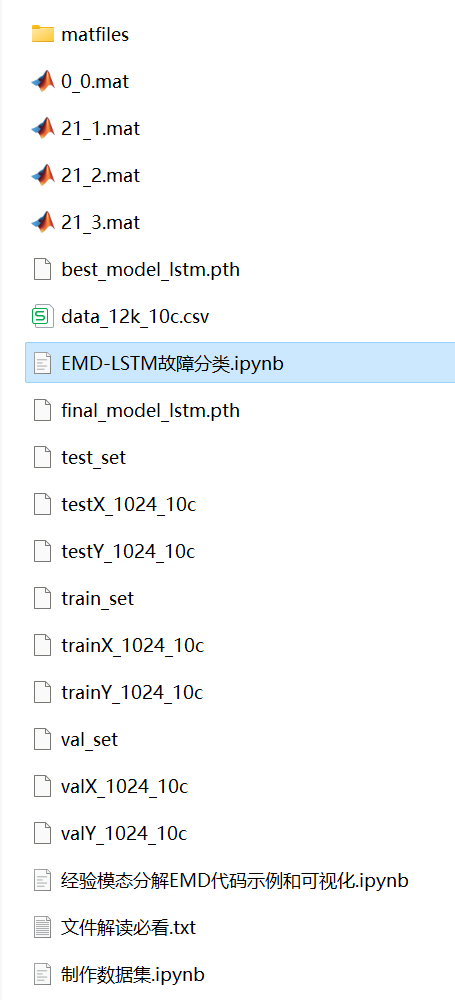
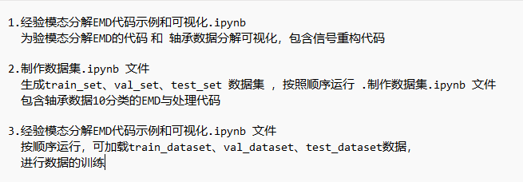

# Python-based EMD-LSTM Bearing Fault Classification

Includes:
- Complete bearing fault dataset
- Generated EMD decomposed fault signal dataset, classification data, and label set
- All code can be run
- EMD decomposition example

Environment: Python 3.9

\n\n\n\n

## Images

<!-- PAYMENT_BLOCK -->

## Get this dataset

- Payment link (Stripe): [Buy now](https://buy.stripe.com/3cs8yP7sY87d0vu9AB)
- Payment QR code: 

<!-- /PAYMENT_BLOCK -->
